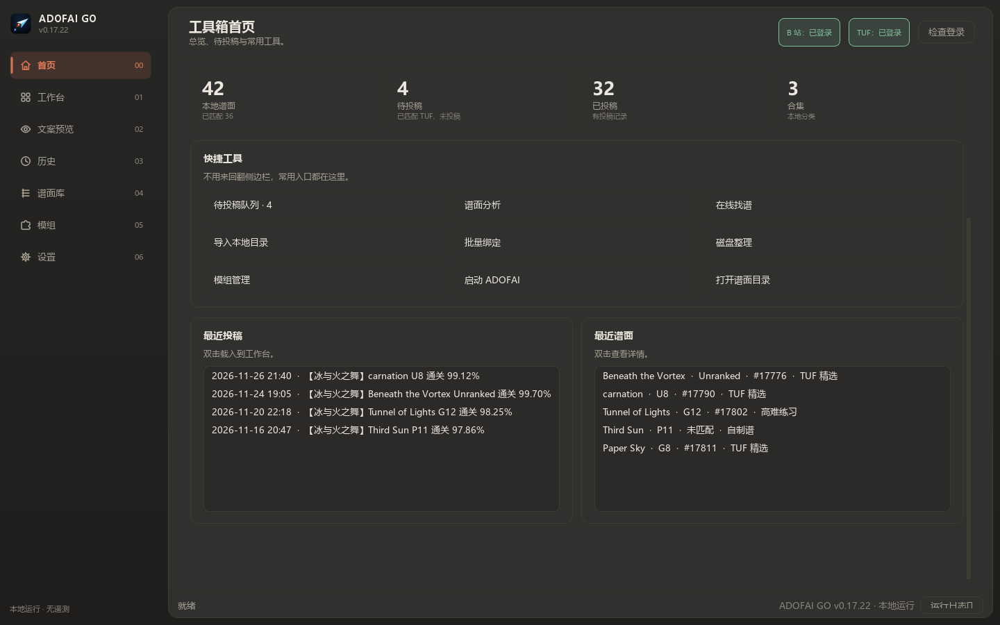
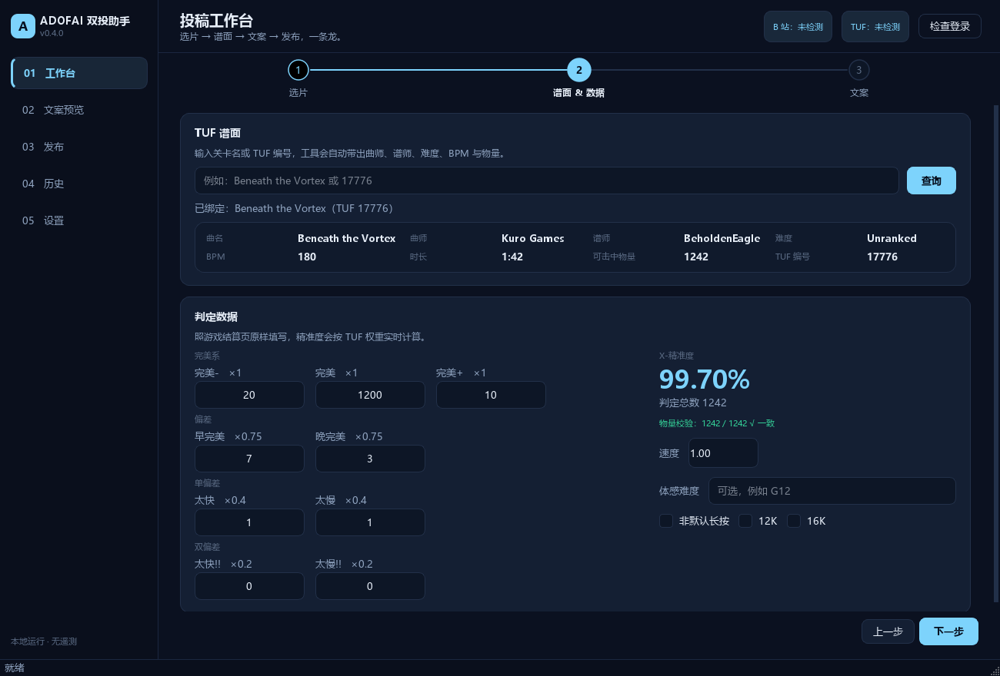
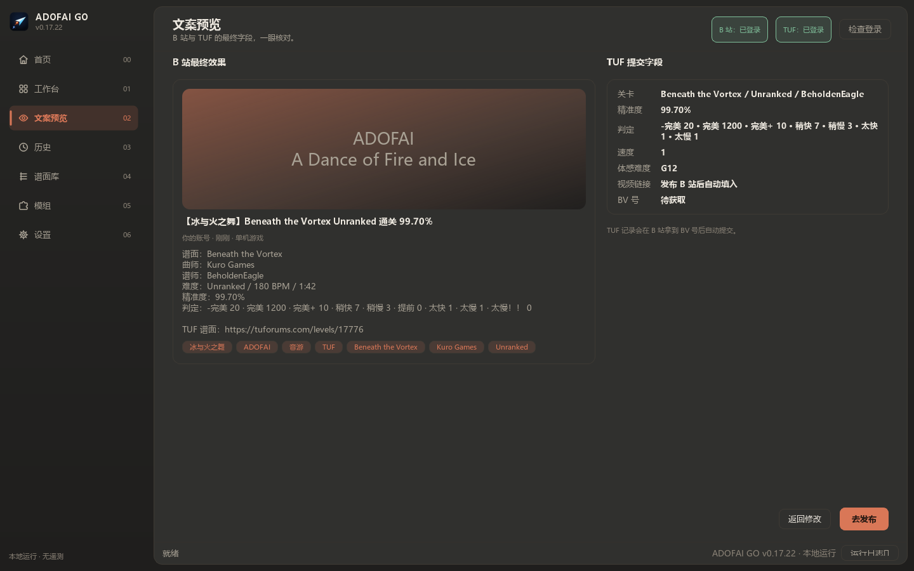

<div align="center">


# ADOFAI GO

给《冰与火之舞》（A Dance of Fire and Ice）UP 主用的本地投稿工作台：
录完视频只填一次信息，工具负责生成 B 站文案、上传 B 站、抓取 BV 号，再把通关记录提交到 TUF 论坛。

**v0.17.23 Beta** · Windows 10/11 · Python 3.11+ / PySide6 · MIT

[**下载最新版**](https://github.com/DeanClock/ADOFAI-GO/releases/latest) ·
[快速开始](#quickstart) ·
[核心功能](#features) ·
[界面预览](#screenshots) ·
[常见问题](#faq) ·
[更新日志](CHANGELOG.md) ·
[开发指南](docs/DEVELOPMENT.md)

</div>

---

<a id="why"></a>
## 为什么用 ADOFAI GO

传统流程要填两遍同样的数据：

1. 录好通关视频。
2. 打开 B 站投稿页，手写标题、简介、标签，上传视频。
3. 等审核 / 发布，复制 BV 号。
4. 打开 TUF 论坛，再手填一遍谱面、判定、准度、视频链接。

判定次数、准度、物量校验都容易抄错。ADOFAI GO 把流程压成一次录入、自动双投：

1. 拖入视频。
2. 输入 TUF 编号或关卡名，自动带出谱面信息。
3. 照游戏结算页填判定，准度与物量自动校验。
4. 一键生成 B 站标题 / 简介 / 标签并自动上传，抓取 BV 号。
5. 点「提交 TUF 记录」，复用登录态直接提交。

数据全部保存在本机，不上传任何第三方服务器（B 站与 TUF 本身除外）。

---

<a id="features"></a>
## 核心功能

### 投稿工作台

- **五步投稿**：发布方式 → 选片 → 谱面 & 数据 → 文案 → 检查与发布；步骤条可点击直达，支持「双投（B 站 + TUF）」与「仅 B 站」。
- **谱面自动带出**：输入关卡名或 TUF 编号，自动补齐曲名、曲师、谱师、难度、BPM、时长与可击中物量；支持 `song:`、`bpm:>`、`#123` 等 TUF 搜索语法。
- **判定与准度**：9 项判定按 TUF 权重实时计算 X-精准度，物量按「打击数」校验，与 TUF 前端同口径。
- **文案生成**：按模板生成标题 / 简介 / 标签，常用词条一键插入或直接新增；改判定会刷新未被手动改过的文案。
- **自动发布**：Playwright 驱动本机 Chrome / Edge 填表、选视频、上传并抓 BV；复用登录态提交 TUF，16:9 主图与 4:3 副图分别预览并进对应框。

### 谱面库与解析

- **在线 TUF**：按关键词、P/G/U 难度区间、Q 难度桶、特殊难度、标签与 Curation 筛选，排序、分页、下载一键入库。
- **下载任务中心**：最多 2 个并发，逐任务显示进度 / 解压 / 取消 / 重试；队列持久化，重开后点「继续下载」才继续。
- **本地谱面库**：已下载 / 未匹配 / 已投稿状态，合集管理、批量绑定、随机抽谱、批量删除（只移除索引，不动磁盘文件）。
- **谱面解析**：支持 `.adofai` / `.ard` / `.zip` / `.adozip`，读取 BPM、物量、中旋、自动砖与事件；容错旧版 `pathData`、缺失 / 多余逗号与裸控制字符。
- **磁盘整理**：按分类 / 难度 / 合集预览迁移，自动备份并生成可撤销历史，冲突项绝不覆盖。

### 模组与游戏联动

- **内置 UMM**：自动探测 Steam 游戏目录，一键安装 / 卸载 UMM 本体，识别 Doorstop 与 Assembly 两种注入方式。
- **模组管理**：8 个常用 ADOFAI mod 的安装、启停、卸载；ADOFAI Tools 在线资源浏览与安装。
- **Bridge 开打**：谱面库「在游戏中打开」通过 Bridge Mod 按绝对路径载入谱面，不移动、不复制原文件。
- **启动与热键**：一键启动 ADOFAI（Steam 版走 `steam://`），游戏内唤起热键默认 `Alt+X`。
- **OBS 录制**：自动查找并启动 OBS，通过 WebSocket 开始 / 停止录制，停止后给出保存路径。

### 本地优先与自动更新

- **数据在本机**：设置、历史、草稿与谱面库都在 `%APPDATA%\AdofaiTufBridge\`（便携版在 exe 同目录），备份复制整个目录即可。
- **凭证只复用 Cookie**：不保存账号密码，不读取浏览器密码库；日志统一脱敏，不记录 Cookie。
- **无遥测**：不收集、不上传使用数据；联网只发生在 B 站、TUF、GitHub 更新仓库，以及你手动使用的模组资源源。
- **更新体验**：启动静默检查 GitHub Release，提示牌整卡跳转设置页；应用内下载、SHA256 校验，退出后由独立 helper 替换 exe，失败自动回滚。
- **深浅主题**：深色工作室风格为默认，可切换浅色。

---

<a id="screenshots"></a>
## 界面预览

| 首页 | 谱面与判定 | 文案预览 |
| :---: | :---: | :---: |
|  |  |  |
| 首页汇总谱面库、待投稿队列、最近投稿与快捷工具 | 绑定 TUF 谱面后录入 9 项判定 | 左侧 B 站效果，右侧 TUF 提交字段 |

---

<a id="quickstart"></a>
## 快速开始

### 普通用户

1. **下载并运行**：到 [Releases](https://github.com/DeanClock/ADOFAI-GO/releases/latest) 下载最新 `exe`，双击即可。便携版首次启动会在 exe 同目录生成 `ADOFAI GO 数据\`；升级时先完全退出旧版，再用新 exe 覆盖，登录态、谱面库、草稿都会保留。
2. **首次登录**：打开「06 设置 → 工具与账号」，点「打开浏览器登录双站」，在弹出的窗口里分别登录 B 站和 TUF，两个站点都登录后自动结束等待。工具不保存账号密码。
3. **开始投稿**：把视频拖进「01 工作台」，按五步填完信息；第 5 步点「上传到 B 站」，拿到 BV 号后点「提交 TUF 记录」。这次投稿会写入「03 历史」。

> 双击提示「应用程序控制策略已阻止此文件」是 Windows 智能应用控制（SAC）拦截了未签名程序，可在「Windows 安全中心 → 应用和浏览器控制 → 智能应用控制」中关闭；也可以先用源码版 `run.cmd`。

<details>
<summary><b>从源码运行（开发者）</b></summary>

需要 Python 3.11+、Windows 10/11：

```powershell
git clone https://github.com/DeanClock/ADOFAI-GO.git
cd ADOFAI-GO
python -m pip install -r requirements.txt
.\run.cmd
```

`run.cmd` 会自动选择仓库 `.venv` 里能导入 PySide6 的 Python，失败时按 `.venv\pyvenv.cfg` 回退，从任意目录运行都可以。排障时只打印将要执行的命令、不启动界面：

```powershell
.\run.cmd --print-command --page workspace --tab 4
```

常用页面直达参数：

```powershell
python run.py --page library        # 04 谱面库
python run.py --page analyzer       # 谱面分析器
python run.py --page umm            # 05 模组
python run.py --page styleguide     # 隐藏样张页
python run.py --selftest            # 运行自检，结果写入 selftest.log
.\run.cmd --page workspace --tab 4  # 工作台第 4 步（文案）
```

测试、打包与自检见[开发指南](docs/DEVELOPMENT.md)。

</details>

---

<a id="faq"></a>
## 常见问题

<details>
<summary><b>B 站页面没有自动填上，或遇到验证码 / 风控？</b></summary>

B 站投稿页改版时选择器可能失效，工具会写日志并保留浏览器窗口，这时在窗口里手动补填即可，工具仍会继续等待并尝试抓 BV 号。工具不会绕过验证码；建议使用日常活跃、频率正常的账号，不要短时间连续大量投稿。

</details>

<details>
<summary><b>TUF 提示未登录？</b></summary>

打开「设置 → 打开浏览器登录双站」重新登录 TUF。Cookie 失效后 TUF 接口返回未登录是正常的安全行为；工具通过浏览器上下文请求，刷新令牌会自动回写。

</details>

<details>
<summary><b>登录时报「工具浏览器窗口仍在运行」？</b></summary>

这是浏览器配置目录被占用，不是账号问题。关闭工具打开的 Edge / Chrome 窗口（不是你日常使用的那个），再点「检查登录」；仍然失败就打开「设置 → 清除登录数据」后重新登录一次。

</details>

<details>
<summary><b>提示找不到浏览器？</b></summary>

设置页可选 `Chrome`、`Edge` 或 `内置 Chromium`。三者都不可用时，先安装 Chrome / Edge，或执行：

```powershell
python -m playwright install chromium
```

</details>

<details>
<summary><b>界面中文显示成方块？</b></summary>

程序启动时会注册微软雅黑（`C:\Windows\Fonts\msyh.ttc`）。系统精简掉该字体时，请安装中文字体，或在设置里换用系统自带中文字体。

</details>

<details>
<summary><b>视频太大传不上去？</b></summary>

B 站网页投稿对大文件不友好，超过 8GB 时工具会提示。建议先压缩 / 剪辑，或改用 B 站客户端投稿后手动粘贴 BV 号。

</details>

完整 FAQ（TUF 字段、登录排查、数据兼容等）见[使用指南](docs/GUIDE.md#faq)。

---

<a id="docs"></a>
## 文档与许可

| 文档 | 内容 |
| --- | --- |
| [使用指南](docs/GUIDE.md) | 界面导览、第一次使用、判定与准度、文案模板、数据位置、完整 FAQ、已知边界与安全声明 |
| [开发指南](docs/DEVELOPMENT.md) | 仓库结构、测试、打包、自检与开源发布前检查 |
| [更新日志](CHANGELOG.md) | 从 v0.4.0 到当前版本的全部更新记录 |
| [安全策略](SECURITY.md) | 支持范围、漏洞报告方式与威胁模型 |
| [第三方组件与许可](THIRD_PARTY_NOTICES.md) | 依赖版本、许可证清单、许可证全文位置与 PySide6 / Qt 的 LGPLv3 说明 |
| [许可证](LICENSE) | MIT |

- 所有历史、草稿、设置都在本机；工具不发送遥测，也不保存账号密码。
- 本项目采用 **MIT** 许可证。PySide6 以 **LGPLv3** 使用（未修改、动态链接），其源码获取与替换 / 重新链接方式见[第三方组件与许可](THIRD_PARTY_NOTICES.md)。
- 作者：**DeanClock**
