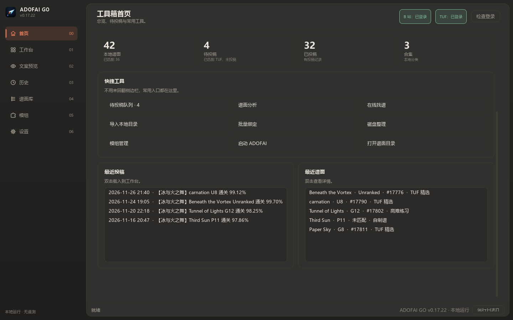
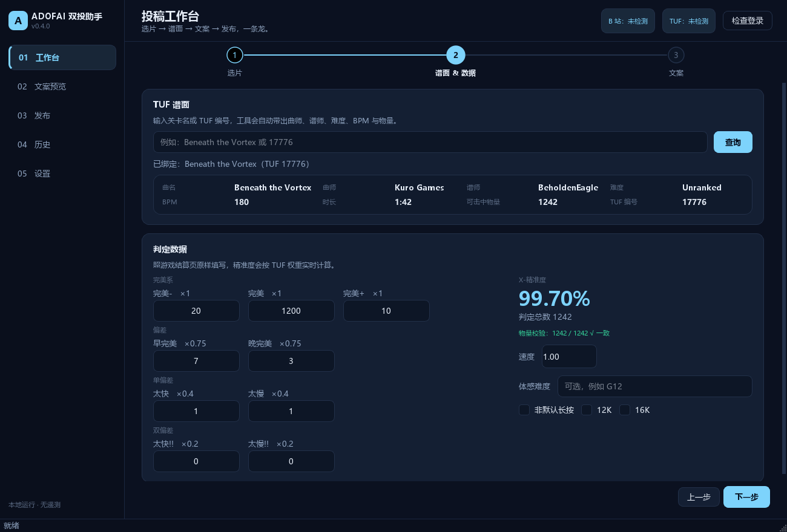
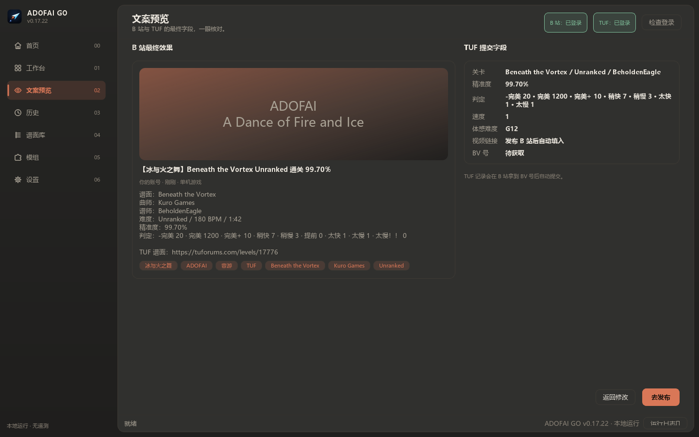

# ADOFAI GO 使用指南

本指南覆盖界面导览、第一次使用、判定与准度、文案模板、数据位置、常见问题与安全边界。
返回 [README](../README.md) · [开发指南](DEVELOPMENT.md) · [更新日志](../CHANGELOG.md)

---

## 界面导览

主窗口左侧是导航，右侧是当前页面：

| 页面 | 用途 |
| --- | --- |
| 00 首页 | 谱面库统计、待投稿队列、快捷工具与最近动态 |
| 01 工作台 | 发布方式 → 选片 → 谱面 & 数据 → 文案 → 检查与发布，五步完成投稿 |
| 02 文案预览 | 核对 B 站最终效果与 TUF 提交字段 |
| 03 历史 | 按曲名 / 标题 / BV 号 / TUF 编号搜索，按状态与审核筛选；审核列按状态上色，右键可载入、复制 BV 号、打开 B 站视频或删除 |
| 04 谱面库 | 在线浏览 TUF 谱面并下载入库；本地谱面按已下载、未匹配、已投稿状态管理 |
| 05 模组 | 内置 UMM 模组加载器，一键安装 / 卸载 UMM 与 ADOFAI 相关 mod |
| 06 设置 | 主题、浏览器、模板、默认标签、存档校验、双站登录、OBS 录制、软件更新；有未保存修改时保存栏会提示 |

工作台顶部有步骤条，可以点击步骤直接跳转；底部固定「上一步 / 下一步」。
当历史里已有记录时，第二步下方会出现「最近投稿」，点击任意一条即可载入。

谱面分析可直接运行：

```powershell
python run.py --page analyzer
```

也可以在 `00 首页` →「快捷工具」→「谱面分析」打开，拖入 `.adofai`、`.ard`、`.zip` 或 `.adozip`。
分析结果可以直接加入本地谱面库（只写索引，不复制文件），也可以带着谱面信息进入投稿流程。

设置页的「存档校验」会读取 ADOFAI 的 `data.sav`，检查游戏是否处于严格判定模式。

### 模组管理

「05 模组」页提供内置 UMM（Unity Mod Manager）模组加载器：

```powershell
python run.py --page umm
```

也可以在 `00 首页` →「快捷工具」→「模组管理」打开。

- 游戏目录默认自动从 Steam 探测（注册表 + `libraryfolders.vdf`），也可手动指定。
- 「游戏目录」卡片里的「启动游戏」可直接启动 ADOFAI；首页「快捷工具」也有「启动 ADOFAI」入口。
- 「一键安装 UMM」按官方 DoorstopProxy 方式安装：复制 UMM 本体文件，生成根目录
  `winhttp.dll` 与 `doorstop_config.ini`，并把运行库装进
  `<游戏>_Data\Managed\UnityModManager\`（含运行时 `Config.xml`）；运行时配置优先
  复制安装器自带的 ADOFAI 配置，安装器里没有时才用内置兜底并写日志提示。
  运行时 `Config.xml` 用 `RelativeModsDirectory` 指向游戏根目录的 `Mods`：
  UMM 把这个字段相对自身程序集目录（`<_Data>\Managed\UnityModManager`）解析，
  默认值 `../Mods` 会落到 `Managed\Mods`（UMM 找不到就自建空目录，Mods 列表为空）；
  安装时按实际目录算出相对路径（通常 `..\..\..\Mods`），并删掉旧版写入的无效
  `ModsDirectory` 子元素。已有配置里的启动挂点等字段原样保留，只补/改该字段与
  缺失的 `ModInfo`；安装结束与卸载时顺带清掉旧的空 `Managed\Mods`。
  安装器自带的 `UnityModManagerConfig.xml` 原样保留，不再手写覆盖。
  官方 UMM 0.33 及以上的安装包改用 `ModsDirectory`（相对游戏根目录），
  只有 0.32.4 fork 使用 `RelativeModsDirectory`；安装时按安装包类型生成运行时配置。
  **本地没有安装器时会先自动下载安装包再安装**，新机器直接点「一键安装 UMM」即可，
  不需要先点「在线更新 UMM」。下载先走 UMM 官方源；官方更新包托管在 Dropbox，国内常被
  拒绝连接（`WinError 10061`，GitHub 镜像也不转发），此时自动改用 **Thunderstore** 的
  ADOFAI 专用 UMM 包（[ADOFAI_Modding/UMM_ADOFAI](https://thunderstore.io/package/ADOFAI_Modding/UMM_ADOFAI/)，
  基于 UMM 的 ADOFAI 预配置版），包内 `UMM/Core/*` 布局会归一化成安装器目录结构
  （`winhttp.dll` 改名为 `winhttp_x64.dll` 供 doorstop 注入）。两个源都失败时提示
  「下载失败」，同时列出两个源各自的原因和手动兜底方式。
  「卸载 UMM」会一起清掉这三样注入文件，只删除 `Managed\UnityModManager` 这一层，
  不影响 Mods、`Managed` 下其它文件与游戏本体。
- 安装器来源优先读取设置里的自定义安装器目录，默认是工具数据目录
  `%APPDATA%\AdofaiTufBridge\UnityModManagerInstaller`。
  两处都没有（或数据目录里的安装器被清空）时，「一键安装 UMM」会自动下载安装包补齐，
  用户自己指定的完整安装器目录不会被替换。
- 「在线更新 UMM」会从 UMM 官方更新仓库（`newman55/unity-mod-manager` 的
  `Repository_beta_13.json`）读取最新版本并下载更新包，解压到工具数据目录后，
  再点「一键安装 UMM」即可安装到游戏目录。国内网络可在下拉框选择镜像源
  （`gh-proxy.com` / `ghfast.top` / `ghproxy.net`），官方直连为默认选项之一。
- 在线更新前会弹出免责声明：UMM 由第三方开发者维护，本工具仅提供下载与安装辅助，
  不修改、不注入任何代码，不保证其稳定性、安全性或与游戏版本的兼容性，
  下载与安装风险由使用者自行承担。
- 默认下载源为 GitHub 官方直连；国内网络变慢时可手动切到 `gh-proxy.com` / `ghfast.top` / `ghproxy.net`。
- 「从本地更新包安装」同时接受 UMM 官方 `umm_update.zip` 和 Thunderstore 的 UMM_ADOFAI 包
  （含 `UMM/Core/` 前缀），两种布局都会归一化成同一套安装器目录结构；包内其它文件
  （`.so`、`run_umm.sh`、`manifest.json` 等）直接丢弃，路径做越界防护。
- 「ADOFAI GO Bridge」卡片显示桥接 Mod 的安装状态、游戏内在线心跳、已装/期望版本，
  并提供「一键安装」「打开日志」「刷新状态」「修复安装」「卸载 Bridge」。
  默认不会静默安装；可在卡片勾选「需要时自动安装」，或在首次「在游戏中打开」时选择。
  不安装不影响谱面库、下载、整理、投稿等桌面功能。
- 「游戏内唤起热键」默认 `Alt+X`，支持录制单键、组合键和双击修饰键。
  热键由桌面端全局监听，不依赖 Bridge；软件保持运行即可，窗口可以最小化。
- 「ADOFAI Tools 资源」区块可浏览第三方站点 [adofaitools.top](https://www.adofaitools.top) 的公开模组：
  点「登录 ADOFAI Tools」会在独立浏览器窗口打开登录页，你在窗口里手动登录，
  工具只从请求头读取并保存登录令牌，**不接触账号密码**；令牌失效时重新登录即可。
  登录后可切换资源类型（模组 / 资源包 / 着色器 / 插件 / 库 / 工具 / 其他），
  点「下载并安装」把资源解压到游戏 `Mods\<slug>`。
  ADOFAI Tools 为第三方站点，本工具仅代为读取其公开资源，不对内容与安全性作任何保证。
- 相关 mod（AdofaiTweaks、ADOFAISkins、CreplayMod、LevelLibrary、Quartz、TogetherBootstrap、
  TUFPlay、YouTubeStream）以卡片列出，显示名称、版本、作者与已安装状态。
- 点「安装」把 zip 安全解压到 `游戏目录\Mods\<mod>\`；已安装的 mod 可一键「启用 / 禁用」或「卸载」。
- 多个版本的 mod 会先弹出版本选择框，再安装所选版本。
- 安装、卸载、启用 / 禁用等文件操作都在后台线程执行，安装较大的 mod 时界面不会卡住。

### 快捷键

| 快捷键 | 功能 |
| --- | --- |
| `Ctrl+N` | 新建投稿（会清空当前草稿） |
| `Ctrl+J` | 打开工作台第 5 步执行区；已在执行区、双投且有 BV 号时直接提交 TUF |
| `Ctrl+0` | 打开工具箱首页 |
| `Ctrl+1` ~ `Ctrl+6` | 切换工作台、预览、历史、谱面库、模组、设置 |

### 界面预览

首页：



谱面与判定录入：



文案预览：



---

## 第一次使用

### 直接运行 exe

从 [Releases](https://github.com/DeanClock/ADOFAI-GO/releases/latest) 下载的 exe 是 onefile 单文件，双击即可；
首次启动会解压运行库，比源码运行慢几秒。默认数据目录是 `%APPDATA%\AdofaiTufBridge\`；
只有在 exe 同目录放了 `portable.txt` 时（分发 zip 自带该文件），才会改用 exe 旁的 `ADOFAI GO 数据\`。

自己打包的产物：

```text
dist\ADOFAI GO.exe
```

升级时先完全退出旧版，再把新 exe 放进原来的文件夹打开，登录态、谱面库、草稿都保留。

### 从源码运行

推荐用仓库根的 `run.cmd`。它会自动找到仓库 `.venv` 里的 Python，从任意目录运行都可以：

```powershell
.\run.cmd
.\run.cmd --page workspace --tab 4
```

`run.cmd` 会先验证 `.venv\Scripts\python.exe` 能 `import PySide6`；不行就按 `.venv\pyvenv.cfg` 里的 `home` 找基础解释器，并自动补上依赖路径。两者都不可用时会给出明确错误。排障时可以只打印将要执行的命令、不启动界面：

```powershell
.\run.cmd --print-command --page workspace --tab 4
```

双击启动请用 `run.cmd`，或仓库根的 `启动ADOFAI GO.bat`（它内部调用的就是 `run.cmd`，失败时会把错误留在控制台并暂停）。**不要再用 `pythonw run.py` 这种旧入口**：`pythonw` 没有控制台，PATH 上的 Python 一旦没有 PySide6 就会静默退出，看起来就是「双击后什么窗口都没有」。

手动装依赖与直接运行时：

```powershell
python -m pip install -r requirements.txt
python run.py
```

要求 Python 3.11+，Windows 10/11。`python run.py` 仍然可用，但要自己保证用的是 `.venv` 的解释器；手敲完整 Python 路径容易出错，不推荐。

开发、测试与打包使用：

```powershell
python -m pip install -r requirements-dev.txt
```

### OBS 录制（可选）

录制有两条路线，按自己的习惯选一条即可。

**路线 A：手动录制（零配置）**

1. 直接打开 OBS，按你平时的方式录制。
2. 录完把视频拖进「01 工作台」。
3. 不需要配置本工具的 OBS 卡片，也不影响后续投稿。

**路线 B：让工具控制开始/停止**

1. 打开「06 设置」，找到「录制（OBS）」。
2. 点「启动 OBS」。OBS 未运行时会自动启动；已运行时会直接测试连接。
3. 在 OBS 打开「工具 → WebSocket 服务器设置」，勾选「启用 WebSocket 服务器」。
4. 复制服务器密码，粘贴到工具设置页的密码框。
5. 点「测试连接」，成功后再点「开始录制」。
6. 停止录制后，工具会显示保存路径，并提供「打开文件夹」。

工具只启动 `obs64.exe`，不会修改 OBS 配置文件，也不会读取或展示 OBS
配置里的密码。地址默认 `127.0.0.1`、端口默认 `4455`；只有改过 OBS 端口
或把 OBS 装在非默认目录时，才需要展开「高级设置」。

**OBS 自动查找**

点「启动 OBS」时，工具按下面顺序找 `obs64.exe`，命中第一个就停：

1. 「高级设置 → OBS 程序」里填的路径（填了就以它为准）；
2. `PATH`；
3. `Program Files` / `Program Files (x86)` / `ProgramW6432` 下的
   `obs-studio\bin\64bit\obs64.exe`；
4. 注册表卸载表里 `DisplayName` 含 OBS 的项（`InstallLocation` 或 `DisplayIcon`），
   所以装在其它盘、Steam 版也能识别；
5. Steam 库：读 `steamapps\libraryfolders.vdf` 里所有库目录
   （Steam 根目录取自 `HKCU\Software\Valve\Steam\SteamPath`）；
6. `%LOCALAPPDATA%\Programs\obs-studio\bin\64bit\obs64.exe`（用户级安装）。

注册表或 Steam 库读不到时只会跳过该来源，不影响其它位置。找到后会启动
并在状态栏显示实际使用的路径；实在找不到时，状态栏会列出查过的位置。

**OBS 排查**

- 没装 OBS：点「启动 OBS」后选择 `obs64.exe`，或在「高级设置」里手动指定。
- OBS 没启动：先点「启动 OBS」，等几秒后再点「测试连接」。
- WebSocket 服务器没启用：在 OBS 的「工具 → WebSocket 服务器设置」里勾选启用。
- 密码错误：重新复制 OBS 里的服务器密码，粘贴后点「测试连接」。
- 端口不通：确认 OBS 端口与工具「高级设置」里的端口一致。
- 没配置录制输出：先在 OBS 的「设置 → 输出」和「设置 → 录像」里选好录制路径。
- 停止后没有保存路径：检查 OBS 的录像输出设置，确认录制确实已经开始。

### 登录 B 站与 TUF

第一次使用必须登录一次：

1. 打开「设置」。
2. 找到「工具与账号」卡片。
3. 点「打开浏览器登录双站」。
4. 在弹出的浏览器窗口里分别登录 B 站和 TUF。
5. 工具会自动检测，两个站点都登录后自动结束等待。

登录过程中右上角按钮会变成「取消登录」，随时可以手动取消；
直接关闭工具打开的浏览器窗口也会立即结束等待，不会继续卡在「登录中」。

登录态保存在工具专用浏览器配置目录：

```text
%APPDATA%\AdofaiTufBridge\browser_profile\
```

工具不保存账号密码，只复用浏览器 Cookie。之后启动时会自动检查登录态，
右上角会显示「B 站：已登录 / TUF：已登录」；点这两个芯片会直接跳到
「设置 → 工具与账号」的登录区。

登录失败时工具会区分四种情况并给对应处理建议：浏览器起不来、登录窗口被关、
等待超时、窗口开着但站点没登录。每 4 秒的检测结果（B 站 / TUF 登录态、
浏览器候选顺序与各候选失败原因）都会写进 `logs\app.log`，**写入前统一脱敏，不含 Cookie**。
也可以在「设置 → 工具与账号」点「复制诊断信息」，把版本、系统、
浏览器候选顺序、profile 目录是否存在和最近一次登录错误一次性复制给作者。

TUF 的登录 Cookie 保存在 `api.tuforums.com` 子域。工具现在直接通过
浏览器上下文访问 TUF API，Cookie 与刷新令牌会由浏览器自动携带和回写，
不会出现“浏览器里明明已登录、工具却一直显示未登录”的问题。

### 工作台五步

#### 第一步：发布方式

- 左侧选择「双投（B 站 + TUF）」或「仅 B 站」。
- 选择会立即写入设置，下次打开仍沿用上次的模式。
- 仅 B 站模式不要求绑定 TUF 谱面，也不校验判定与物量。
- 右侧「继续上次草稿」可恢复上次没填完的草稿，「最近投稿」直达历史页。
- 退出前工具会自动保存未完成草稿，下次启动时恢复。

#### 第二步：选片

- 把视频拖进虚线区域，或点击区域选择文件。
- 支持 `MP4 / FLV / MOV / MKV / AVI / WMV / WEBM / M4V`。
- 推荐 1080P 60fps；超过 8GB 时工具会提示网页投稿可能失败。
- 视频只在本机读取，不会先上传到工具自己的服务器。
- 右侧是两槽封面：主槽放 **16:9 主图**，副槽放 **4:3 副图**（JPG / PNG / WEBP）；
  两个槽各自预览自己的图，槽位按钮用 ✓ 标出已选图的槽；4:3 未上传时预览显示空状态，
  可用下方「用这张同步 4:3」生成，不会拿主图裁剪版顶替。
- 选好主图后点「用这张同步 4:3」，工具会用 `QImage` 居中裁剪生成副图，
  存到 `%APPDATA%\AdofaiTufBridge\cache\cover_sync\`；两个槽也可以各自拖入或单独清除。
- 投稿时两张图分别进 B 站「封面制作」弹窗的两个框：**4:3 副图 → 首页推荐封面（4:3）**，
  **16:9 主图 → 个人空间封面（16:9）**。只选了一张时两个框都用这张图。
- 「双比例同步改动」由工具按张数设置：两张图时**取消勾选**（否则调一张会覆盖另一张），
  只有一张图时**勾选**（两框保持一致）；找不到勾选框只记日志，不会中断上传。
- 两张封面都传完后会停在弹窗里等你在浏览器里确认，工具不会替你点发布。
- 都不选时，B 站会从视频帧自动生成封面。

#### 第三步：谱面 & 数据

- 在搜索框输入关卡名或 TUF 编号，例如 `Beneath the Vortex` 或 `17776`。
- 一次最多显示 100 个候选（服务端单页上限）；原文命中 0 或 1 条时会自动去掉括号内容、标点再查一次。
- 查到多个结果时会弹出选择框，顶部写明候选总数；已知编号可直接输入编号精确查询。
- 绑定后自动显示：曲名、曲师、谱师、难度、BPM、时长、可击中物量、TUF 编号。
- 照游戏结算页填写 9 项判定。
- 右侧实时显示 X-精准度、判定总数、物量校验结果。
- 速度默认 `1.00`；体感难度在双投模式下必填，例如 `G12`（仅 B 站模式可留空）。
- 「非默认长按 / 12K / 16K」按需勾选。

##### 搜索语法（第三步 / 谱面库在线搜索）

搜索框内容会原样交给 TUF 服务器，支持字段过滤与组合条件，不区分大小写：

| 写法 | 含义 | 示例 |
| --- | --- | --- |
| `字段:值` | 包含该值（部分匹配） | `song:carnation` |
| `字段=值` | 完全匹配 | `id=1234` |
| `,` | 同时满足（AND） | `song:hello, artist:camellia` |
| `\|` | 任一满足（OR） | `song=goTe \| song:xnor` |
| `\!` | 排除包含该词（NOT） | `song:hello \!artist:camellia` |
| `#编号` | 按 TUF 编号 | `#1234` |
| `>` `<` `>=` `<=` | 数值比较 | `bpm:>150`、`tilecount:>=1000` |

- 文本字段：`song`、`artist`、`creator`、`charter`、`vfxer`、`team`、`comment`。
- 数值字段：`bpm`、`tilecount`、`time`（h / m / s / ms，缺省毫秒）、`likes`、`clears`。
- 编号 / 链接：`id`、`#123` 简写、`dlLink`、`workshopLink`、`legacyDllink`、`videolink`。
- 值里可以带空格；`A,B|C,D` 表示 `(A 且 B) 或 (C 且 D)`。
- 用了字段语法后只查一次，不会再去掉括号或标点重搜；普通关键词仍保留原来的回退行为。
- 搜索框旁的「搜索语法」按钮可随时打开速查（工作台第 3 步与谱面库在线搜索都有）。

#### 第四步：文案

- 顶部「常用词条」卡片按判定 / 成绩 / 手感分组，点击词条会插入到光标处。
- 卡片右侧的「新增词条」可以直接添加词条并即时保存，不必再去设置页；分组、去重规则与设置页一致。
- 标题框有焦点时插入标题；标签框有焦点时插入标签；否则插入简介。插入会自动处理空格和换行，不会和相邻文字粘连。
- 标题、简介、标签会自动生成。
- 创作声明是 B 站必填项，默认「内容无需标注」，可在这里切换；投稿时会自动选择。
- 修改判定后会刷新文案；一旦你手动改过标题/简介/标签，工具就不再覆盖你的版本。
- 想恢复自动版本，点「自动生成文案」。
- 文案下方是「文案预览」卡片，改文案会实时刷新 B 站效果与 TUF 字段预览。

#### 第五步：检查与发布

- 「提交前检查」会用红色标出必须修的问题，黄色标出建议修的问题。
- 下方「本次投稿 / 执行发布 / 执行日志」卡片负责上传 B 站、保存 BV、提交 TUF 与执行日志。

### 预览与发布

在工作台第 4 步的「文案预览」卡片里就能核对，也可以打开侧边栏「02 文案预览」：

- 左侧是 B 站最终效果卡片。
- 右侧是 TUF 提交字段。
- 确认无误后点「去发布」，会回到工作台第 5 步并定位到「执行发布」卡片。

工作台第 1 步可选择「双投（B 站 + TUF）」/「仅 B 站」，默认沿用上次模式：

1. 点「上传到 B 站」。
2. 工具打开 B 站投稿页，自动填标题/简介/标签、选择视频、上传。
3. 上传过程中会显示百分比与执行日志。
4. 上传完成后工具尝试抓取 BV 号。
5. 如果自动抓取失败，可以手动把 BV 号粘贴到输入框，点「保存 BV」。
6. 点「提交 TUF 记录」。
7. 成功后状态灯变绿，记录进入历史。

选「仅 B 站」时不需要绑定 TUF 谱面，也不校验判定与物量；上传按钮变为「仅上传到 B 站」，
TUF 提交按钮隐藏，历史记录状态显示「仅 B 站」，不会计入谱面库的「已投稿」。

### 谱面库

「04 谱面库」分为「在线 TUF」与「本地谱面」两个视图：

- 在线 TUF：进入页面后自动加载首屏，可按关键词、难度滑条、特殊难度、标签和 Curation 筛选，并按最近收录、难度、通关数、点赞、PP、BPM 等排序。难度区一行是 `P/G/U 难度` 双把手滑块（P1–U20，把手热区 24px，悬停放大，区间被拖成一个点后按拖动方向仍能拉开），下一行左端是 `排序` 下拉与升/降序按钮，右端依次是 `特殊难度 / Q 难度 / Curation / 标签 / 重置 / 标准视图`；面板下方只保留一行细状态（左侧 `已显示 N 条`、右侧总结果数），长提示收进悬停提示，把更多高度留给结果列表；1080×720 最小窗口下筛选行不再硬裁，文字完整显示，窗口更窄时按钮显示省略号，悬停可看全文。`Q 难度` 是下拉框：Qq、GQ0~GQ4、UQ0~UQ4 共 11 个桶（每桶覆盖 4 个小级），默认全选，也可以一个都不选（= 不带任何 Q 桶），菜单底部有「全选 / 全不选」。关键词支持 TUF 搜索语法（如 `song:carnation`、`bpm:>150, tilecount:>=1000`），旁边的「搜索语法」按钮可查字段与示例。
- 卡片会显示难度、TUF 编号、PP、曲师、标签、时长、物量、BPM、midspin、通关与点赞数据。
- 点「下载」会直接调用 TUF 下载接口保存到有效谱面根目录，并立即写入本地谱面库；设置页留空时会优先采用本地库中占多数的真实谱面目录，而不是固定写进 `%APPDATA%`。
- 本地谱面复用同一套卡片；有 TUF 编号的显示「已下载」，仅本地导入的显示「未匹配」，命中投稿历史的显示「已投稿」。
- 本地视图支持关键词搜索、状态筛选（全部 / 已下载 / 未匹配 / 已投稿）和分类筛选（全部分类 / P / G / U / 未评级 / Censored / Impossible / 合集）。
- 本地视图支持按「最近更新 / 名称 / 难度」排序，并可在升序与降序之间切换；难度排序按 P1–P20、G1–G20、U1–U20 排列，无级别条目排在最后。
- 本地难度滑条与在线 TUF 一致，范围为 P1–U20；全量程显示所有条目，缩窄后只保留范围内谱面和可识别级别的谱面。
- 「随机抽谱」会从当前筛选结果中抽取一张，滚动定位并高亮；连续抽取不会立刻重复同一张。
- 解析谱面时会自动去除 `<color>`、`<size>` 等 Unity 富文本标签；已入库的旧条目在显示和排序时也会自动清洗。
- 未匹配条目可在详情面板「绑定 TUF 编号」：支持直接输编号或关键词搜索；绑定只更新库记录，不移动、不重命名本地文件。
- 若该 TUF 编号已存在于谱面库，会弹出选择：「合并为一条」保留当前条目路径并合并标签，或「保留双份」；两种方式都不会删除磁盘文件。扫描导入的已绑定条目可「解除绑定」。
- 本地工具栏「批量绑定」会为所有未匹配谱面自动搜索候选：优先用 BPM 与物量向 TUF 精确查询，其次只查 BPM，最后才按曲名兜底。只有四元组（BPM / 物量 / 中旋 / 自动砖）全等且唯一时才自动勾选，多张或仅名称匹配一律标黄待确认；逐行复核勾选后可批量绑定。批量遇到重复编号时可选择全部合并、全部保留双份或逐条询问。
- 下载默认按难度自动归档：`P/P14/曲名/`、`G/G1/曲名/`、`U/U7/曲名/`；未评级进 `Unranked/`，Censored 与 Impossible 各自独立目录。重名时自动追加谱师与 TUF 编号。可在设置页关闭「下载时按难度分类存放」。
- TUF 下载默认会先按难度归到目标目录，再安全解压成谱面文件夹并删除压缩包；主谱面统一优先识别 `level.adofai` / `main.adofai`。可在设置页关闭「TUF 下载后自动解压成文件夹」。
- 下载过程中会显示谱面名、百分比、已下载 / 总大小；下载完成后切换为「正在解压并归类」状态，失败或完成时自动收起。
- 导入本地目录时，如果它与当前谱面根目录不同，会询问是否设为默认谱面目录；导入本身仍只写索引，不复制、不移动文件。
- 关闭自动解压时会保留服务器返回的压缩包后缀（通常是 `.zip`，少数为 `.adozip`），不再强行改成 `.ard`；本地库可以直接把压缩包当作一张谱面管理。
- 本地扫描以「文件夹 + 压缩包」为单位：同一文件夹里的 `.adofai` / `.ard`、音频、封面作为一张谱面，优先选择 `level*` / `main*`；`.zip` / `.adozip` 各自作为独立谱面包入库，若旁边已有同名解压目录则跳过压缩包，避免重复。
- 顶层目录不是 P/G/U 时识别为「合集」，例如 `自定义谱/智柚下和/...`；卡片和详情会显示合集名。
- 本地工具栏新增「合集管理」，可新建空合集、重命名合集或解散合集；详情面板可把单张谱面归入已有合集，或直接输入新名称创建合集。
- 合集筛选会显示每个合集的谱面数量；选择某个合集时会自动切到「合集」分类。合集归类、改名和解散只更新谱面库索引，不移动、复制或删除本地文件。
- 本地工具栏「磁盘整理」会先展示迁移计划：按当前分类、难度与合集规则计算每张谱面的目标目录，并标记「可移动 / 已就位 / 冲突 / 跳过」。预览阶段不会移动任何文件。
- 整理表格默认不勾选任何条目，只有「可移动」项能勾选；支持按关键词和状态筛选，筛选后「全选可移动」只作用于当前可见项，被隐藏的勾选会自动清除。
- 整理表格支持「全选可移动 / 清空选择」，按钮会显示当前选中数量与当前可见行数。适合先选少量谱面试运行，再逐步整理。
- 确认应用后只移动勾选的整张谱面文件夹，不使用复制；本地库中来自其他目录的谱面也可以移入当前根目录，目标已存在、源目录等于根目录或源目录包含根目录的条目会保留原状。整理前自动备份谱面库并生成可撤销清单，位于 `%APPDATA%\AdofaiTufBridge\organize_history`。
- 整理窗口提供「撤销上次整理」，按最近一份清单把已移动的文件夹移回原位置；冲突与跳过项始终不会被自动覆盖。
- 整理窗口的「整理历史」会列出历次整理记录，可按关键词、可撤销/失败/已全部撤销等状态筛选；选中记录后还能在当前记录内搜索谱面。
- 历史明细会显示每张谱面的移动状态、原位置、目标位置和失败原因。可以撤销整条记录，也可以勾选其中几张谱面单独撤销，不影响同批次的其他条目或之后的整理。
- 本地谱面工具栏也提供「整理历史」入口，不需要先打开磁盘整理预览。
- 撤销历史记录前会再次备份谱面库；已撤销、失败或已被后续操作改变的条目会安全跳过，并在明细中显示原因。
- 单击卡片只选中；双击卡片或点「详情」可查看完整元数据、标签、外部链接、ARD 详档和该谱面的投稿历史，详情左上角显示 TUF 曲绘。
- 本地谱面详情新增「在游戏中打开」：软件把谱面路径写进 Bridge 请求，游戏内 `ADOFAI GO Bridge` Mod 收到后调用 `scnEditor.OpenLevel`，直接在 ADOFAI 编辑器中载入这张谱面；原库文件不移动、不复制、不修改。
- Bridge Mod 安装到 `Mods\ADOFAIGOBridge`。默认首次使用会询问，可在「05 模组」页一键安装、卸载，或勾选「需要时自动安装」；首次安装或更新后需要完全重启一次 ADOFAI。之后游戏运行中也能直接切换谱面。若游戏未启动，软件会先启动游戏再发送请求。
- 如果载入后被游戏内其他全屏界面挡住，按 `Esc` 关闭即可看到编辑器中的谱面。
- 目标目录已存在时不会覆盖或合并，并提示冲突；复制失败会清理本次产生的半成品。

---

## 判定与准度

判定录入对齐 TUF `/submission/pass` 的真实表单，算法照 TUF 官网
`/submission/pass/calculator` 的前端源码（变量名与源码一致）。结算页出现
`-完美 / 完美+` 时勾上「X 完美」，界面会在 6 格与 8 格之间切换：

- X 完美关闭：稍快 / 完美 / 稍慢，提前 / 太快 / 太慢。
- X 完美开启：-完美 / 完美 / 完美+，稍快 / 稍慢，提前 / 太快 / 太慢。

| 界面标签 | 本工具字段 | TUF 提交字段 | 权重 |
| --- | --- | --- | --- |
| -完美 | `perfectMinus` | `perfectMinus` | 1.0 |
| 完美 | `perfect` | `perfect` | 1.0 |
| 完美+ | `perfectPlus` | `perfectPlus` | 1.0 |
| 稍快 | `ePerfect` | `ePerfect` | 0.75 |
| 稍慢 | `lPerfect` | `lPerfect` | 0.75 |
| 提前 | `earlyDouble` | `earlyDouble` | 0.2 |
| 太快 | `earlySingle` | `earlySingle` | 0.4 |
| 太慢 | `lateSingle` | `lateSingle` | 0.4 |
| 太慢！！ | `lateDouble` | `lateDouble` | 0.2 |

提交时同时带 `isXPerfectMode` 表示当前模式。字段名以 TUF 前端为准：网页表单里的
`tooEarly` / `early` / `late` 只是界面键，前端 `Oe()` 会先把它们转成内部键
`earlyDouble` / `earlySingle` / `lateSingle` 再提交，服务端校验 `os()` 也只认
内部键；直接发界面键会被静默丢弃，TUF 记录里存成 0。工具因此只发内部键。
「太慢！！」在网页表单里没有输入框，但内部键 `lateDouble` 是被识别的，工具
保留键值、权重并一并提交。

### 两种计数口径

判定面板下方常驻两行小字，分别对应 TUF 前端 `sumJudgements` 与
`tilecount` 两个函数：

```text
判定总数（九格） = -完美 + 完美 + 完美+ + 稍快 + 稍慢 + 提前 + 太快 + 太慢 + 太慢！！
打击数           = 判定总数 − 提前 − 太慢！！
```

- **判定总数（九格）** 是准度的分母，也就是界面上的「判定总数」。
- **打击数** 是 TUF 用来核对物量的那个数。「提前」「太慢！！」是没落到
  轨道上的击打，游戏结算页会把它们并进判定，但它们不算砖块。

物量校验只看打击数：

```text
可击中物量 = floor(tilecount) − floor(autoTileCount)   （不小于 0；中旋不加）
打击数必须 = 可击中物量
```

这就是「判定总数 974 与可击中物量 973 不一致」会误报的原因：多出来的是
提前 / 太慢！！，TUF 自己不认为它不一致。现在工具按打击数判断，文案里会
同时列出九格和、砖块总数与自动砖块数。

### 准度

```text
X-精准度 = (完美− + 完美 + 完美+
          + (稍快 + 稍慢) × 0.75
          + (太快 + 太慢) × 0.4
          + (提前 + 太慢！！) × 0.2) / 判定总数（九格） × 100%
```

「提前」和「太慢！！」虽然有 0.2 的权重，但不计入打击数，也不参与物量校验。

### 中旋

TUF 原文：「This chart has {{count}} midspin tiles. They will be subtracted
from Perfect when you submit.」但 TUF 前端 `midspinPerfectDecrement` 只在
`adofaiVersion` 低于 3.4.0 时才执行；3.4.0 起已经是「latest_era」，结算结果
本身包含中旋，不再额外扣。工具按同样的规则处理：

- 提交 3.4.0（工具默认）或更高版本：`完美` 原样提交，不扣中旋。
- 提交 3.3.x / 2.x 等旧版本：`完美` 减去中旋数，结果提示「完美已按中旋数
  减去 N」；`完美 < 中旋数` 时不调整（TUF 同样不调整），不会出现负数。
- 版本号解析不出来时按 3.4.0+ 处理，不扣。

中旋不加进物量；如果 `打击数 + 中旋数` 恰好等于砖块总数，TUF 会提示「游戏
版本错误」，请把游戏版本改成 3.4.0 之后再结算。

---

## 文案模板

设置页可以修改标题模板和简介模板。可用变量：

| 变量 | 含义 |
| --- | --- |
| `{song}` | 曲名 |
| `{artist}` | 曲师 |
| `{charter}` | 谱师 |
| `{difficulty}` | 难度 |
| `{bpm}` | BPM |
| `{duration}` | 时长 |
| `{accuracy}` | X-精准度 |
| `{tuf_id}` | TUF 编号 |
| `{tuf_url}` | TUF 谱面链接 |
| `{bvid}` | B 站 BV 号 |
| `{partition}` | 分区 |
| `{speed}` | 速度 |
| `{perfectMinus}` 等 | 对应判定次数 |

同一张「文案模板」卡片还可以管理常用词条：内置「严判 / 标判 / 严判击破 / 完美无瑕 /
全连 / AP / FC / 零失误 / 手感极佳」，按「判定 / 成绩 / 手感」分组显示在工作台。
支持新增、编辑、删除和恢复内置词条，修改后点击「保存设置」；词条保存在
`settings.json` 的 `copy_snippets` 字段中，重启后仍然保留。工作台的「常用词条」卡片
也能直接新增词条并即时保存，日常加词条不用再进设置页。

默认标题模板：

```text
【冰与火之舞】{song} {difficulty} 通关 {accuracy}
```

默认简介会写入谱面、曲师、谱师、难度、BPM、时长、精准度、9 项判定和 TUF 链接。

标签默认取设置里的「默认标签」，再自动补曲名、曲师、难度，最多 10 个，单个不超过 20 字。

---

## 数据位置与兼容

默认数据目录：

```text
%APPDATA%\AdofaiTufBridge\
```

| 文件/目录 | 内容 |
| --- | --- |
| `settings.json` | 主题、浏览器、模板、默认标签、OBS、UMM 等全部设置 |
| `records.json` | 投稿历史 |
| `draft.json` | 未完成草稿 |
| `level_library.json` | 本地谱面库元数据（分类、合集、投稿状态关联） |
| `levels\` | 默认谱面库目录（设置里可改为其他盘） |
| `browser_profile\` | 工具专用浏览器配置与登录态 |
| `cache\` | 临时缓存：谱面预览、曲绘、TUF 元数据、ADOFAI Tools 下载、UMM 安装包 |
| `logs\` | 运行日志（`app.log`）与启动失败日志（`startup-error.log`），不记录 Cookie |
| `organize_history\` | 磁盘整理历史与可撤销清单 |
| `UnityModManagerInstaller\` | UMM 安装器与 mod 参考文件 |
| `adofaitools_token.json` | ADOFAI Tools 登录令牌（不含密码） |
| `download_queue.json` | 下载队列（重开后保留为「等待中」） |
| `selftest.log` | `--selftest` 自检输出，可用 `ADOFAI_SELFTEST_OUT` 改路径 |

运行日志：

```text
%APPDATA%\AdofaiTufBridge\logs\app.log
```

日志不记录 Cookie；遇到错误时可以把这份日志提供给维护者。

旧版 `ADOFAI投稿助手 v0.3.0` 使用同一数据目录，`records.json` 可以直接读取。
新版记录新增了 `bpm / duration_ms / tilecount / auto_tile_count` 等可选字段，
旧记录缺少这些字段也不会报错，只是载入后谱面详情会少几项。

备份时直接复制整个 `%APPDATA%\AdofaiTufBridge\` 即可。

---

<a id="faq"></a>
## 常见问题

### B 站页面没有自动填上

B 站投稿页 DOM 会改版。工具按多组选择器尝试，失败时会写日志并保留浏览器窗口。
这时请在打开的浏览器里手动补填，工具仍会继续等待并尝试抓 BV 号。

### 遇到验证码或风控

工具不会绕过 B 站验证码。遇到时请在浏览器里手动完成本次投稿。
建议使用日常活跃、频率正常的账号，不要短时间连续大量投稿。

### TUF 提示未登录

打开「设置」→「打开浏览器登录双站」，重新登录 TUF。
Cookie 失效后 TUF 接口会返回未登录，这是正常的安全行为。

v0.4.2 修复了 TUF 登录态被误判的问题：TUF 的会话 Cookie
（`accessToken` / `refreshToken` / `csrfToken`）位于 `api.tuforums.com`，
旧版本只读取了 `tuforums.com`，所以即使已经登录也会显示「未登录」。

另外，TUF 的 `refreshToken` 会在刷新会话时轮换。旧版本把 Cookie 复制给
`requests` 后没有写回浏览器，轮询几次就会把登录态消耗掉。v0.4.2 改为
调用浏览器上下文的网络请求，刷新令牌会自动更新。**如果你在旧版本里
反复点过「检查登录」或「登录」，TUF 可能已经掉线，需要重新登录一次。**

### 登录时报「工具浏览器窗口仍在运行」

这是浏览器配置目录被占用，不是账号问题。常见原因：

- 工具打开的 Edge/Chrome 登录窗口还开着；
- 上次关闭软件时登录窗口没有关闭；
- 连续点击了「登录」和「检查登录」。

处理方式：

1. 关闭工具打开的 Edge/Chrome 窗口（不是你日常使用的那个窗口）。
2. 再点「检查登录」。
3. 如果仍然失败，打开「设置」→「清除登录数据」，然后重新登录一次。

v0.4.1 已限制同一时间只能有一个浏览器任务，并把这类错误改成简短提示，
不会再弹出整段 Playwright 启动命令。

v0.4.2 进一步保证：关闭登录浏览器窗口会立即结束等待；登录期间按钮会变成
「取消登录」，不需要关掉整个软件。TUF 刷新令牌也会自动回写浏览器。

### TUF 提交字段不对

TUF 使用的是网页端私有接口，字段命名可能调整。`tuf_submitter.py` 只提交 TUF 前端
同款的内部字段；如果返回 `422`，工作台第 5 步「执行发布」的日志会显示服务端校验原因。

### 提示找不到浏览器

设置页的浏览器可选：

- `Chrome`：使用本机安装的 Chrome。
- `Edge`：使用本机安装的 Edge。
- `内置 Chromium`：使用 Playwright 自带浏览器。

如果三者都不可用，先安装 Chrome/Edge，或执行：

```powershell
python -m playwright install chromium
```

### 界面中文显示成方块

程序启动时会注册 `C:\Windows\Fonts\msyh.ttc`（微软雅黑）。
如果系统精简掉了微软雅黑，请安装中文字体，或在设置里换用系统自带中文字体。

### 视频太大

B 站网页投稿对大文件不友好。超过 8GB 时工具会提示，
建议先压缩/剪辑，或改用 B 站客户端投稿后手动粘贴 BV 号。

---

## 已知边界与安全声明

- B 站投稿页结构可能随时变化，自动填表是「尽力适配」，不是官方 API。
- B 站验证码/风控不会绕过，遇到时请手动完成。
- TUF 提交使用网页端同款接口，接口变更可能需要更新代码。
- 工具不保存账号密码，不读取浏览器密码库，只使用工具专用浏览器配置里的 Cookie。
- 工具不发送遥测；除 B 站、TUF 与你配置的 GitHub 更新仓库外，不向第三方上传任何数据。
- 更新检查只读取 GitHub 公开 Release；应用内下载必须由用户点「下载并安装更新」触发，安装包按同名 `.sha256` 资产校验。替换只发生在应用退出后：独立 PowerShell helper 等待旧进程退出 → 备份旧 exe 为 `.old` → 覆盖 → 失败回滚；下载与替换都不触碰数据目录（`%APPDATA%\AdofaiTufBridge` 或 portable 的 `ADOFAI GO 数据`）。
- 所有历史、草稿、设置都在本机 `%APPDATA%\AdofaiTufBridge\`。
- 工具启动 OBS 或 ADOFAI 时会用干净的环境变量：从 `PATH` 里剔除本工具（PyInstaller onefile）的 `_MEI` 解包目录，并去掉 `PYTHONHOME` / `PYTHONPATH`，避免对方进程从临时目录加载运行库、锁住本工具的临时目录。

### 登录数据与威胁模型

登录态存放在：

```text
%APPDATA%\AdofaiTufBridge\browser_profile\
```

这个目录等同于一份浏览器登录数据。同一 Windows 账户下的其他程序、
恶意软件或管理员权限攻击者可以读取它；工具不会额外加密这个目录。

设置页提供「清除登录数据」，只删除工具数据目录内部的浏览器配置，
不会影响你日常使用的 Edge/Chrome。不要在公开 Issue、截图或聊天里
发送这个目录、`settings.json`、`records.json` 或 `draft.json`。

更多安全说明与漏洞报告方式见 [SECURITY.md](../SECURITY.md)。

### 许可证

本项目采用 **MIT** 许可证，见 [LICENSE](../LICENSE)。

PySide6 采用 LGPLv3 / GPLv3 / 商业许可三重授权，若你基于本项目打包 exe 分发，
需要自行确认 PySide6 的合规要求（例如提供可替换的 Qt 动态库或遵循 LGPL 条款）。
以上不构成法律意见。
